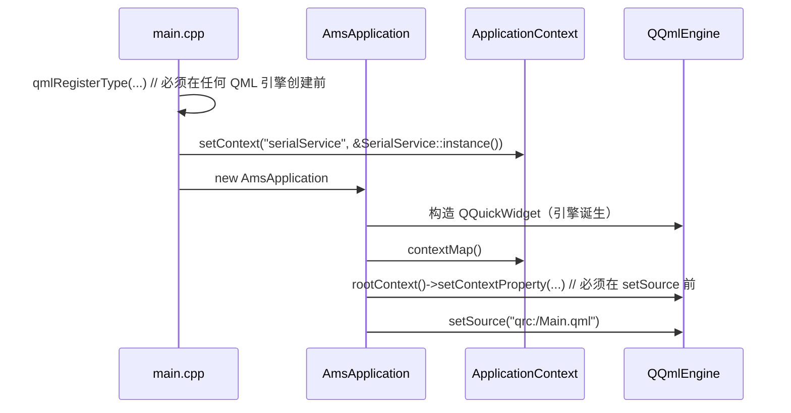

# DOD-D_Serial — QWidget + QML 骨架（Qt5 / CMake / 多平台）

QWidget 主窗承载一个 `QQuickWidget`；QML 走 qrc 编进 exe；Model 与全局服务按 WTC3 的方式注册。

---

## 一、目录结构

```text
DOD-D_Serial/
├── CMakeLists.txt          # 只做入口 + 顺序编排（真正的配置在 cmake/ 下）
├── cmake/                  # 构建脚本拆成 9 个子文件
│   ├── ProjectConfig.cmake        #   输出目录 / C++17 / MOC-UIC-RCC
│   ├── SourceFilesConfig.cmake    #   源文件与 include 目录清单
│   ├── Qt5Config.cmake            #   定位 Qt5（QTDIR / 常见安装目录）
│   ├── ThirdPartyConfig.cmake     #   第三方依赖（spdlog / Threads）
│   ├── TargetConfig.cmake         #   可执行目标 + 平台属性
│   ├── LinkLibrariesConfig.cmake  #   链接依赖
│   ├── QmlConfig.cmake            #   QML(qrc) 资源依赖
│   ├── PackageConfig.cmake        #   run / windeployqt / create-package
│   └── Summary.cmake              #   配置结论输出
├── CMakePresets.json       # debug / release 两个 preset
├── main.cpp                # 入口：注册 QML 类型 + 登记全局服务 + 起窗口
├── App/                    # 应用层：窗口与全局上下文
│   ├── AmsApplication.*    #   QWidget 主窗，加载 QML、注入上下文属性
│   └── ApplicationContext.*#   全局对象注册表（名字 -> QObject*）
├── Model/                  # 模型层：暴露给 QML 的类型
│   └── SerialPortModel.*   #   QAbstractListModel 示例
├── Service/                # 服务层：业务单例
│   └── SerialService.*     #   串口服务示例（Q_INVOKABLE + NOTIFY 属性）
├── Utility/                # 基础设施
│   ├── Log.h               #   日志门面（业务只用 LOG_xxx 宏）
│   └── Log.cpp             #   唯一依赖 spdlog 的文件
├── third_party/spdlog/     # 可选的本地 spdlog，未提供时查找系统包或下载
├── Qml/                    # 视图层
│   ├── Qml.qrc             #   资源清单（prefix=/ → qrc:/Main.qml、qrc:/Common/…）
│   ├── Main.qml            #   默认页面（GeneralCombox 用法演示）
│   ├── SerialDemo.qml      #   Model + 服务 + 网卡演示页
│   └── Common/             #   qmldir 模块：import Common 1.0
│       ├── qmldir
│       └── GeneralCombox.qml
├── .clang-format
└── .vscode/                # tasks / launch / settings
```

| 目录       | 放什么                                   | 依赖方向                           |
| ---------- | ---------------------------------------- | ---------------------------------- |
| `App/`     | 窗口、应用级装配（注册、注入）           | 可依赖 Model / Service             |
| `Model/`   | `QAbstractListModel`、`QObject` 数据模型 | 可依赖 Service                     |
| `Service/` | 业务单例、IO、协议栈                     | 不依赖 Model / App                 |
| `Utility/` | 日志、配置等基础设施                     | 被各层使用                         |
| `Qml/`     | QML 页面与组件                           | 通过类型/上下文访问 Model、Service |

新增一层（例如 `Protocol/`）时：建目录 → 在 `cmake/SourceFilesConfig.cmake` 的源文件清单和 include 目录里各加一行。
新增第三方库 → 改 `cmake/ThirdPartyConfig.cmake`；加打包步骤 → 改 `cmake/PackageConfig.cmake`。

---

## 二、Model 与全局服务怎么注册（对齐 WTC3）

两条通道，职责不同：

| 通道           | WTC3 里的写法                                                             | 适合放什么                       | QML 用法                         |
| -------------- | ------------------------------------------------------------------------- | -------------------------------- | -------------------------------- |
| **QML 类型**   | `qmlRegisterType<T>(...)`                                                 | Model、可被 QML `new` 出来的对象 | `SerialPortModel { id: m }`      |
| **上下文属性** | `ApplicationContext::setContext(name, obj)` + 逐窗口 `setContextProperty` | 全局单例服务                     | `serialService.connectPort(...)` |

补充两种“只读暴露”的注册方式，用来给 QML 提供枚举：

```text
qmlRegisterUncreatableType<T>(...)           // 类里的枚举
qmlRegisterUncreatableMetaObject(NS::staticMetaObject, ...)  // 命名空间里的枚举
qmlRegisterSingletonInstance<T>(..., ptr)     // 单例直接当 QML 类型用（不用注入上下文）
```

时序（顺序错了会找不到类型或属性）：



要点：

- **每个窗口都要注入一次**：每个 `QQuickWidget` 有自己的 `QQmlEngine`，`ApplicationContext` 只是“登记表”，不是自动传播的。
- **类型注册在引擎创建之前**；上下文属性在 `setSource()` 之前。
- 单例的生命周期跟随进程（用函数内 `static`），不要被 QML 拥有；Model 由 QML 创建时随 QML 对象树销毁。
- Model 必须在 GUI 线程被访问；Service 内部的 IO 线程只负责发信号回主线程。

---

## 三、QML 组件模块（qmldir）

`Qml/Common/` 是一个可复用组件目录，用 `qmldir` 声明成一个模块，页面里直接 `import`：

```text
Qml/
├── Main.qml                 import "Common"  →  GeneralCombox { }
├── Common/
│   ├── qmldir               module Common
│   └── GeneralCombox.qml    ComboBox 封装（selectedValue / hoveredIndex / 颜色属性…）
└── Qml.qrc                  把 qmldir 也登记进去
```

`Qml/Common/qmldir`：

```text
module Common

GeneralCombox 1.0 ./GeneralCombox.qml
```

两种 import 写法都靠这个 `qmldir`：

| 写法                                    | 能用的前提                                                 | 说明                                                                                      |
| --------------------------------------- | ---------------------------------------------------------- | ----------------------------------------------------------------------------------------- |
| `import "Common"`（目录导入，**推荐**） | 模块目录与使用它的 QML 同级                                | qmlls 与运行时都正常；qmldir 里的 `module` 行可不用                                       |
| `import Common 1.0`（命名模块）         | 引擎 `addImportPath("qrc:/")`，使 `Common` → `qrc:/Common` | 运行时可用；但 **Qt5 + qrc 下 qmlls 会误报** `GeneralCombox missing import "qrc:/Common"` |

所以本项目统一用目录导入，同时保留 `addImportPath("qrc:/")`（以后真需要命名模块时直接可用）。

三件事必须同时成立，否则会报 `is not a type` / `module is not installed`：

| 环节     | 做法                                                             |
| -------- | ---------------------------------------------------------------- |
| 模块声明 | `qmldir` 里写 `module Common`                                    |
| 组件登记 | `类型名 版本 ./文件名`，类型名可与文件名不同                     |
| 可见性   | 目录导入靠相对位置；命名模块靠 `addImportPath` + qrc 中的 qmldir |

注意：`qmldir` 本身也要放进 `Qml.qrc`，否则运行时它在 qrc 里不存在。

页面里的用法：

```qml
import "Common"

GeneralCombox {
    width: 180
    height: 28
    model: ["ttyUSB0", "ttyUSB1", "ttyS0"]
    pixelSize: 13
}
```

新增一个通用组件：把文件放进 `Qml/Common/`，在 `qmldir` 里加一行，再在 `Qml.qrc` 里加一行。
子目录也可以自成模块（如 `Common/GeneralDialog/qmldir` → `module Common.GeneralDialog` → `import Common.GeneralDialog 1.0`）。

---

## 四、日志（spdlog + 可替换门面）

业务侧只有一个入口：

```text
LOG_DEBUG("已注入全局对象 ({} 个): {}", count, names);
LOG_ERROR("加载 QML 失败: {}", url);
```

| 位置                 | 职责                                                             |
| -------------------- | ---------------------------------------------------------------- |
| `Utility/Log.h`      | 门面：`LOG_*` 宏、级别、初始化选项；业务只 include 它            |
| `Utility/Log.cpp`    | **唯一**出现 spdlog 符号的文件：双 sink + Qt 消息转发 + 定时刷盘 |
| `third_party/spdlog` | 可选的本地头文件依赖；否则查找系统包或下载 spdlog                 |

行为约定：

- `{}` 占位符，**QString 可直接传**（Log.h 里给了 fmt formatter），不用 `toStdString()`。
- 级别没开的日志不会格式化，零额外开销。
- 输出：控制台彩色 + `<exe目录>/logs/<appName>.log`（10MB×5 滚动；目录不可写时回退系统应用数据目录）。
- `Log::installQtMessageHandler()` 把 `qDebug/qWarning` 与 **QML 运行时告警**也并入同一份日志（Windows GUI 无控制台时尤其有用）。
- 初始化前打的日志落到 stderr，不丢；退出时 `Log::shutdown()` 把缓冲刷盘。

跨平台处理：

| 平台    | 处理                                                                      |
| ------- | ------------------------------------------------------------------------- |
| Windows | `SetConsoleOutputCP(CP_UTF8)` 防中文乱码；GUI 子系统无控制台时靠文件 sink |
| Linux   | 显式链接 `Threads::Threads`（spdlog header-only 用 `std::thread`）        |
| macOS   | `.app` 内日志在 `Contents/MacOS/logs`，不可写时回退 Application Support   |

换日志库只需动 3 处（业务代码 0 改动）：

1. `CMakeLists.txt`：把 spdlog 那段换成目标库的 target；
2. `Utility/Log.h`：格式化头 + `QString` formatter（换成目标库的格式化方式）；
3. `Utility/Log.cpp`：sink/pattern/刷盘策略换成目标库 API。

---

## 五、构建与运行

### Windows（MSVC x64）

需要 Visual Studio 或 Build Tools 的 **C++ 桌面开发**工作负载、Windows SDK、CMake 3.24 或更新版本，以及与 MSVC x64 匹配的 Qt 5.14/5.15（包括 Quick Controls 2、Quick Widgets、SVG）。首次构建若没有本地或系统 spdlog，需要联网下载；离线时可提供 `third_party/spdlog/include/spdlog/spdlog.h` 或安装 spdlog 的 CMake 包。

在 PowerShell 中将 `QTDIR` 指向 Qt 的编译器目录；例如：

```powershell
$env:QTDIR = 'C:\Qt\Qt5.14.2\5.14.2\msvc2017_64'
cmake --preset debug
cmake --build --preset debug
cmake --build build\debug --config Debug --target run

cmake --preset release
cmake --build --preset release
cmake --build build\release --config Release --target create-package
# 安装 NSIS 3.03+ 并将 makensis.exe 加入 PATH 后：
cmake --build build\debug --config Debug --target create-installer
cmake --build build\release --config Release --target create-installer
```

也可通过 `-DCMAKE_PREFIX_PATH=<Qt目录>` 指定 Qt。切换 Qt、编译器或生成器时，使用新的构建目录，或自行清理对应的旧构建目录后重新配置。构建后 `windeployqt` 将 Qt DLL、插件和 QML 模块复制到可执行文件旁；缺少该工具时配置会报错。

Debug 程序位于 `build\debug\bin\Debug\DOD-D_Serial.exe`，Release 位于 `build\release\bin\Release\DOD-D_Serial.exe`，压缩包位于 `build\release\`。发布到另一台机器时，若 `windeployqt` 提示找不到 VC 运行库，请先安装与目标架构匹配的 Microsoft Visual C++ Redistributable；Debug 构建依赖调试运行库，不适合发布。

Windows 安装程序分别位于 `build\debug\DOD-D_Serial-<版本>-Windows-<架构>-Debug-Setup.exe` 和 `build\release\DOD-D_Serial-<版本>-Windows-<架构>-Release-Setup.exe`。它们使用 NSIS 生成，需要管理员权限安装，并提供独立的安装目录和卸载入口。Release 包含 Qt/QML 依赖和 MSVC 可再分发运行库；**Debug 仅供开发机内部测试，不包含不可再分发的 MSVC 调试运行库，目标机必须安装对应的 Visual Studio C++ 工具集和调试运行库，并将对应架构的 Debug CRT 及 Windows SDK 的 UCRT 调试 DLL 目录加入运行进程的 `PATH`，不能作为发布包**。打包机须安装 NSIS 3.03+，且启动 VS Code 时 `makensis.exe` 应在 `PATH` 中。安装包未签名，Windows 可能提示发布者未知。

**注意**：程序默认尝试连接 `192.168.3.123` 上的 ULX-D 设备，连接成功后会发送频率设置命令。不需要联调时，在运行前设置 `$env:DOD_ULXD_HOST = 'off'`；VS Code 的调试配置中也应相应修改 `DOD_ULXD_HOST`。

### Linux / macOS

```bash
cmake --preset debug
cmake --build --preset debug
cmake --build build/debug --config Debug --target run
cmake --preset release
cmake --build --preset release
cmake --build build/release --config Release --target create-package
```

---

## 六、VS Code 怎么点

| 想做的事         | 操作                                              |
| ---------------- | ------------------------------------------------- |
| 编译 Debug       | `Ctrl+Shift+B`（默认任务 **CMake: 构建 Debug**） |
| 编译 Release     | 运行任务 → **CMake: 构建 Release** |
| 运行程序         | 运行任务 → **CMake: 运行 Debug** 或 **CMake: 运行 Release** |
| 运行 / 调试      | Windows 选择 **Windows / MSVC / Debug** 或 **Windows / MSVC / Release**，然后 `F5` |
| 一键打包 Release | 运行任务 → **打包 Release（一键 zip）**     |
| 一键打包 Windows 安装器 | 在“运行和调试”选择 **打包 Windows Debug 安装程序（仅开发机）** 或 **打包 Windows Release 安装程序（发布）**，然后 `F5` |
| 清理             | 任务 `cmake: distclean`                           |

安装推荐的 CMake Tools 和 C/C++ 扩展，从设置了 `QTDIR` 的环境启动 VS Code；也可以在本机 `CMakeUserPresets.json` 配置 Qt 路径。CMake Tools 选择 `debug` preset，以获得正确的代码补全；Windows 的调试配置会先构建所选的 Debug 或 Release 程序，再启动对应版本，不依赖当前选中的 CMake 启动目标。Release 启用了编译优化，调试信息和断点体验可能不如 Debug。Windows 打包配置会先配置对应版本，再在集成终端运行 CMake 生成安装器，不会启动安装器；也可以通过 `Ctrl+Shift+P` → `Tasks: Run Task` 运行同名任务。改变生成器或 Qt 后需要重新配置旧构建目录。

---

## 七、多平台差异

| 平台    | Qt 运行库                             | 包                       |
| ------- | ------------------------------------- | ------------------------ |
| Windows | 构建后自动 `windeployqt --qmldir Qml` | zip 内 exe + Qt DLL/插件 |
| macOS   | 打包时 `macdeployqt -qmldir=Qml`      | zip 内含完整 `.app`      |
| Linux   | 用系统 Qt                             | zip 内仅可执行文件       |

其它：Windows 默认 GUI 子系统（需要控制台可配置 `-DDOD_WIN32_CONSOLE=ON`）；QML 必须写版本号（如 `import QtQuick.Controls 2.14`）；qrc 是编译期资源，改 QML 必须重新构建。

---

## 八、常见问题

**0. 点按钮没反应 / 只报错**

| 现象                                                          | 处理                                                                 |
| ------------------------------------------------------------- | -------------------------------------------------------------------- |
| `Could not find ... "Qt5"`                                    | 将 `QTDIR` 或 `CMAKE_PREFIX_PATH` 指向与编译器匹配的 Qt 5.14+ 目录 |
| `Could not find ... Qt5QuickWidgets`                          | 选到了系统 5.12，显式 `-DCMAKE_PREFIX_PATH=~/Qt5.14.2/5.14.2/gcc_64` |
| `CMakeCache.txt was created by CMake 4.0.1`                   | 删 `build/`，之后只用一种方式构建                                    |
| `无法解析 ${command:cmake.launchTargetPath}`                  | 先成功 configure + build 一次                                        |
| 终端 `cmake --preset debug` 报 `Unrecognized "version" field` | 终端 CMake 3.20 读不了 preset v3，用 VS Code 按钮或 `-S/-B`          |

**1. QML 里报 `module "DodModel" is not installed`**

类型注册没在引擎创建前执行 —— 检查是否在 `new AmsApplication` 之前调用了注册函数。

**2. QML 里 `serialService is not defined`**

要么没 `setContext`，要么注入发生在 `setSource()` 之后。看启动日志里的 `[AmsApplication] 已注入全局对象:` 有没有列出名字。

**3. 新增了 QML 文件但程序找不到**

要在 `Qml/Qml.qrc` 里登记；资源路径 = `qrc:` + qrc 的 prefix + 文件名。

**4. 黑屏**

先看终端有没有「加载 QML 失败」；再试软件渲染 `QT_QUICK_BACKEND=software`。

---

## 九、速查表

```bash
cmake --preset release
cmake --build --preset release
cmake --build build/release --config Release --target run
cmake --build build/release --config Release --target create-package
```

| 想加什么        | 改哪里                                                                            |
| --------------- | --------------------------------------------------------------------------------- |
| 新 Model        | `Model/` 建类 → `main.cpp` 里 `qmlRegisterType` → `CMakeLists.txt` 加源文件       |
| 新全局服务      | `Service/` 建单例 → `main.cpp` 里 `setContext("名字", ...)` → QML 直接用名字      |
| 新 QML 页面     | 丢进 `Qml/` → `Qml/Qml.qrc` 加一行                                                |
| 新分层目录      | 建目录 → `cmake/SourceFilesConfig.cmake` 的源文件清单 + include 目录各加一行      |
| 打日志          | `LOG_INFO("值={}", v)`；头文件加 `#include "Log.h"`                               |
| 调日志级别/目录 | `main.cpp` 里的 `Log::Options`                                                    |
| 新通用组件      | 放进 `Qml/Common/` → `qmldir` 加一行 → `Qml.qrc` 加一行，页面 `import Common 1.0` |
| 看日志          | 运行目录下 `logs/DOD-D_Serial.log`                                                |
