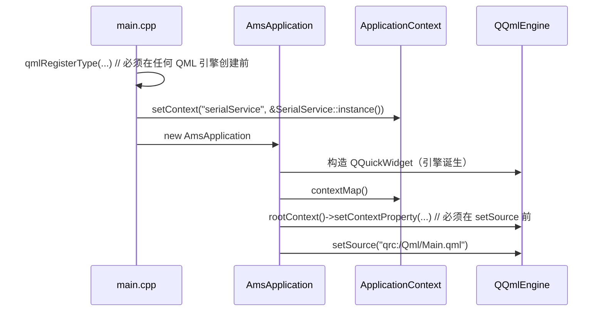

# DOD-D_Serial — QWidget + QML 骨架（Qt5 / CMake / 多平台）

QWidget 主窗承载一个 `QQuickWidget`；QML 走 qrc 编进 exe；Model 与全局服务按 WTC3 的方式注册。

---

## 一、目录结构

```text
DOD-D_Serial/
├── CMakeLists.txt          # 唯一构建入口（分层目录已加入 include path）
├── CMakePresets.json       # debug / release 两个 preset
├── main.cpp                # 入口：注册 QML 类型 + 登记全局服务 + 起窗口
├── App/                    # 应用层：窗口与全局上下文
│   ├── AmsApplication.*    #   QWidget 主窗，加载 QML、注入上下文属性
│   └── ApplicationContext.*#   全局对象注册表（名字 -> QObject*）
├── Model/                  # 模型层：暴露给 QML 的类型
│   └── SerialPortModel.*   #   QAbstractListModel 示例
├── Service/                # 服务层：业务单例
│   └── SerialService.*     #   串口服务示例（Q_INVOKABLE + NOTIFY 属性）
├── Utility/                # 基础设施
│   ├── Log.h               #   日志门面（业务只用 LOG_xxx 宏）
│   └── Log.cpp             #   唯一依赖 spdlog 的文件
├── third_party/spdlog/     # 内置依赖（头文件），clone 即可编译
├── Qml/                    # 视图层
│   ├── Qml.qrc             #   资源清单（prefix=/Qml）
│   ├── Main.qml            #   默认页面
│   └── SerialDemo.qml      #   Model + 服务用法演示页
├── .clang-format
└── .vscode/                # tasks / launch / settings
```

| 目录       | 放什么                                   | 依赖方向                           |
| ---------- | ---------------------------------------- | ---------------------------------- |
| `App/`     | 窗口、应用级装配（注册、注入）           | 可依赖 Model / Service             |
| `Model/`   | `QAbstractListModel`、`QObject` 数据模型 | 可依赖 Service                     |
| `Service/` | 业务单例、IO、协议栈                     | 不依赖 Model / App                 |
| `Utility/` | 日志、配置等基础设施                     | 被各层使用                         |
| `Qml/`     | QML 页面与组件                           | 通过类型/上下文访问 Model、Service |

新增一层（例如 `Protocol/`、`Utility/`）时只需要：建目录 → 在 `CMakeLists.txt` 的源文件列表和 `target_include_directories` 里各加一行。

---

## 二、Model 与全局服务怎么注册（对齐 WTC3）

两条通道，职责不同：

| 通道           | WTC3 里的写法                                                             | 适合放什么                       | QML 用法                         |
| -------------- | ------------------------------------------------------------------------- | -------------------------------- | -------------------------------- |
| **QML 类型**   | `qmlRegisterType<T>(...)`                                                 | Model、可被 QML `new` 出来的对象 | `SerialPortModel { id: m }`      |
| **上下文属性** | `ApplicationContext::setContext(name, obj)` + 逐窗口 `setContextProperty` | 全局单例服务                     | `serialService.connectPort(...)` |

补充两种“只读暴露”的注册方式，用来给 QML 提供枚举：

```text
qmlRegisterUncreatableType<T>(...)           // 类里的枚举
qmlRegisterUncreatableMetaObject(NS::staticMetaObject, ...)  // 命名空间里的枚举
qmlRegisterSingletonInstance<T>(..., ptr)     // 单例直接当 QML 类型用（不用注入上下文）
```

时序（顺序错了会找不到类型或属性）：



要点：

- **每个窗口都要注入一次**：每个 `QQuickWidget` 有自己的 `QQmlEngine`，`ApplicationContext` 只是“登记表”，不是自动传播的。
- **类型注册在引擎创建之前**；上下文属性在 `setSource()` 之前。
- 单例的生命周期跟随进程（用函数内 `static`），不要被 QML 拥有；Model 由 QML 创建时随 QML 对象树销毁。
- Model 必须在 GUI 线程被访问；Service 内部的 IO 线程只负责发信号回主线程。

---

## 三、日志（spdlog + 可替换门面）

业务侧只有一个入口：

```text
LOG_DEBUG("已注入全局对象 ({} 个): {}", count, names);
LOG_ERROR("加载 QML 失败: {}", url);
```

| 位置                 | 职责                                                             |
| -------------------- | ---------------------------------------------------------------- |
| `Utility/Log.h`      | 门面：`LOG_*` 宏、级别、初始化选项；业务只 include 它            |
| `Utility/Log.cpp`    | **唯一**出现 spdlog 符号的文件：双 sink + Qt 消息转发 + 定时刷盘 |
| `third_party/spdlog` | 内置头文件依赖，**别人拉下仓库直接编译**，不用联网/装包          |

行为约定：

- `{}` 占位符，**QString 可直接传**（Log.h 里给了 fmt formatter），不用 `toStdString()`。
- 级别没开的日志不会格式化，零额外开销。
- 输出：控制台彩色 + `<exe目录>/logs/<appName>.log`（10MB×5 滚动；目录不可写时回退系统应用数据目录）。
- `Log::installQtMessageHandler()` 把 `qDebug/qWarning` 与 **QML 运行时告警**也并入同一份日志（Windows GUI 无控制台时尤其有用）。
- 初始化前打的日志落到 stderr，不丢；退出时 `Log::shutdown()` 把缓冲刷盘。

跨平台处理：

| 平台    | 处理                                                                      |
| ------- | ------------------------------------------------------------------------- |
| Windows | `SetConsoleOutputCP(CP_UTF8)` 防中文乱码；GUI 子系统无控制台时靠文件 sink |
| Linux   | 显式链接 `Threads::Threads`（spdlog header-only 用 `std::thread`）        |
| macOS   | `.app` 内日志在 `Contents/MacOS/logs`，不可写时回退 Application Support   |

换日志库只需动 3 处（业务代码 0 改动）：

1. `CMakeLists.txt`：把 spdlog 那段换成目标库的 target；
2. `Utility/Log.h`：格式化头 + `QString` formatter（换成目标库的格式化方式）；
3. `Utility/Log.cpp`：sink/pattern/刷盘策略换成目标库 API。

---

## 四、构建与运行

```bash
cmake -S . -B build -DCMAKE_BUILD_TYPE=Release
cmake --build build -j8
cmake --build build --target run               # 运行
cmake --build build --target create-package    # 打包 zip
```

| 内容                     | 路径                                                  |
| ------------------------ | ----------------------------------------------------- |
| 可执行文件（QML 已内嵌） | `build/bin/`（Windows 多配置为 `build/bin/Release/`） |
| zip 安装包               | `build/DOD-D_Serial-0.1.0-<平台>-<架构>.zip`          |

---

## 五、VS Code 怎么点

| 想做的事         | 操作                                              |
| ---------------- | ------------------------------------------------- |
| 编译 Debug       | `Ctrl+Shift+B`（默认任务 `cmake: build (debug)`） |
| 运行 / 调试      | `F5`                                              |
| 一键打包 Release | `Ctrl+Shift+B` → **打包 Release（一键 zip）**     |
| 清理             | 任务 `cmake: distclean`                           |

---

## 六、多平台差异

| 平台    | Qt 运行库                             | 包                       |
| ------- | ------------------------------------- | ------------------------ |
| Windows | 构建后自动 `windeployqt --qmldir Qml` | zip 内 exe + Qt DLL/插件 |
| macOS   | 打包时 `macdeployqt -qmldir=Qml`      | zip 内含完整 `.app`      |
| Linux   | 用系统 Qt                             | zip 内仅可执行文件       |

其它：Windows 默认 GUI 子系统（要 `qDebug` 加 `-DDOD_WIN32_CONSOLE=ON`）；QML 必须写版本号（`import QtQuick 2.12`）；qrc 是编译期资源，改 QML 必须重新构建。

---

## 七、常见问题

**0. 点按钮没反应 / 只报错**

| 现象                                                          | 处理                                                                 |
| ------------------------------------------------------------- | -------------------------------------------------------------------- |
| `Could not find ... "Qt5"`                                    | 设 `QTDIR`，或装到 `~/Qt5*/*/gcc_64`                                 |
| `Could not find ... Qt5QuickWidgets`                          | 选到了系统 5.12，显式 `-DCMAKE_PREFIX_PATH=~/Qt5.14.2/5.14.2/gcc_64` |
| `CMakeCache.txt was created by CMake 4.0.1`                   | 删 `build/`，之后只用一种方式构建                                    |
| `无法解析 ${command:cmake.launchTargetPath}`                  | 先成功 configure + build 一次                                        |
| 终端 `cmake --preset debug` 报 `Unrecognized "version" field` | 终端 CMake 3.20 读不了 preset v3，用 VS Code 按钮或 `-S/-B`          |

**1. QML 里报 `module "DodModel" is not installed`**

类型注册没在引擎创建前执行 —— 检查是否在 `new AmsApplication` 之前调用了注册函数。

**2. QML 里 `serialService is not defined`**

要么没 `setContext`，要么注入发生在 `setSource()` 之后。看启动日志里的 `[AmsApplication] 已注入全局对象:` 有没有列出名字。

**3. 新增了 QML 文件但程序找不到**

要在 `Qml/Qml.qrc` 里登记；资源路径 = `qrc:` + qrc 的 prefix + 文件名。

**4. 黑屏**

先看终端有没有「加载 QML 失败」；再试软件渲染 `QT_QUICK_BACKEND=software`。

---

## 八、速查表

```bash
cmake -S . -B build -DCMAKE_BUILD_TYPE=Release
cmake --build build -j8
cmake --build build --target run
cmake --build build --target create-package
```

| 想加什么        | 改哪里                                                                       |
| --------------- | ---------------------------------------------------------------------------- |
| 新 Model        | `Model/` 建类 → `main.cpp` 里 `qmlRegisterType` → `CMakeLists.txt` 加源文件  |
| 新全局服务      | `Service/` 建单例 → `main.cpp` 里 `setContext("名字", ...)` → QML 直接用名字 |
| 新 QML 页面     | 丢进 `Qml/` → `Qml/Qml.qrc` 加一行                                           |
| 新分层目录      | 建目录 → CMake 的源文件列表 + `target_include_directories` 各加一行          |
| 打日志          | `LOG_INFO("值={}", v)`；头文件加 `#include "Log.h"`                          |
| 调日志级别/目录 | `main.cpp` 里的 `Log::Options`                                               |
| 看日志          | 运行目录下 `logs/DOD-D_Serial.log`                                           |
